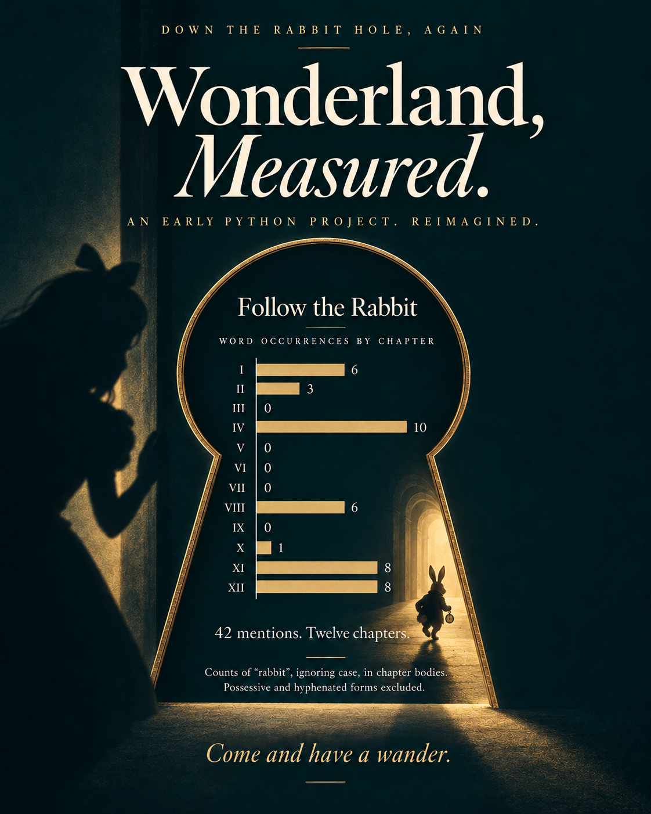
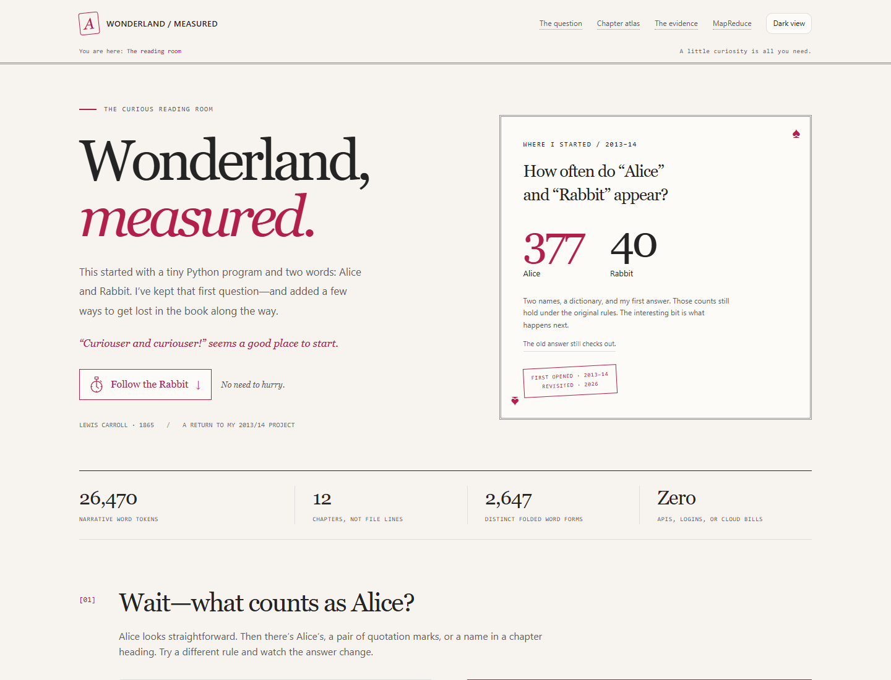

# Wonderland, Measured

### Two words, a Python dictionary, and a very curious book.

<p align="center">
  <a href="https://mberca.github.io/alice-in-wonderland-analysis/">
    
  </a>
</p>

I wrote the first version for a programming project in 2013/14. It counted
**Alice** and **Rabbit** in a text file, then explored character counting with
**MapReduce**. A small question, but a good place to start.

The little counter is still here. Around it: chapter charts, a source search,
and a local version of the old MapReduce exercise. You can follow the numbers
all the way back to the text—or just stop for a little tea.

Underneath, this is a **reproducible Python 3 text-analysis project**: explicit
counting rules, source provenance, JSON/CSV evidence, and focused tests.

**[Visit the reading room](https://mberca.github.io/alice-in-wonderland-analysis/)** · **[Offline HTML](docs/index.html)** · **[Methodology](METHODOLOGY.md)** ·
**[From the original project](EVOLUTION.md)** · **[Source and rights](data/README.md)**

> **An open reading room, online or offline.** Explore the live story above,
> or download this repository and open `docs/index.html` in a browser.
> The HTML is self-contained and works offline; no server or installation is
> needed to explore it.

The **Curious Reading Room** pairs old-storybook details with a little
early-web playfulness: chapter cards, a pocket-watch entrance, notes in the
margin, and room to follow a word wherever it leads.

## Wait—what counts as Alice?

How many times do **Alice** and **Rabbit** appear?

| Counting definition | Alice | Rabbit | Text scope |
|---|---:|---:|---|
| Original exercise, reproduced | **377** | **40** | Supplied file, with the old punctuation/whitespace rules |
| Modern exact-case word tokens | 386 | 39 | Narrative chapter bodies |
| Case-insensitive word tokens | 386 | 42 | Narrative chapter bodies |
| Case-insensitive, also grouping final `'s` | 396 | 46 | Narrative chapter bodies |

These are not contradictory results: they answer different operational
definitions. The original word result is reproduced **exactly**, not quietly
replaced with a new definition.

**A capital discovery.** My first search used lowercase `rabbit` and found
just **2** occurrences. Changing it to `Rabbit` gave **40**. Both results
reproduce under the original, case-sensitive full-file rules. That early
lesson now has its own place in the story, separate from the modern totals.

The supplied edition contains **26,470 narrative word tokens**, **2,647
case-folded word forms**, and **12 chapters** under the documented tokenisation.
Counts are word-form occurrences, **not resolved character identities**.

## A few ways to wander



| Lens | What it adds |
|---|---|
| Counting policies | Change case, possessives, and corpus scope; see why the answer moves. |
| Chapter atlas | Compare counts with occurrences per 1,000 tokens; click through to passages. |
| Word frequencies | Compare all words with a transparent content-word filter. |
| Chapter fingerprints | Inspect TF–IDF weights and fixed-window vocabulary variety, with limitations. |
| Searchable concordance | Search any single word, filter by chapter and matching rule, and read the evidence. |
| Local MapReduce lab | Map, combine, shuffle, and reduce character counts without cloud infrastructure. |
| Source and methods | Inspect the checksum, download the exact source bytes, and read the edition licence. |

Start with **Rabbit**. Its highest raw count is in chapter IV, but its highest
case-insensitive rate per 1,000 tokens is in **chapter XI**. Allowing for chapter
length changes the picture. Then try `curiouser`, `tea`, or `nonsense` in the
concordance. The counter finds the word; you get to read what is happening.

None of that establishes narrative importance or literary causation.

## Reproduce everything

Use **Python 3.10 or later** from a checkout of this repository.
There are **no runtime or test dependencies to install**.

```powershell
python -m wonderland build
python -m unittest discover -s tests -v
python -m wonderland build --check
```

The first command regenerates the evidence in `outputs/` and the standalone
story in `docs/index.html`. `--check` recomputes them and fails on stale or
missing generated files. It does not overwrite them.

Read matching passages from the command line:

```powershell
python -m wonderland query Rabbit --chapter 8 --limit 5
python -m wonderland query Alice --exact
python -m wonderland query Alice --possessives --limit 5
```

`count` is the total number of matches; `--limit` only limits the passages
printed. Multiword phrases are deliberately unsupported.

The program checks the source checksum before analysis. `--source` can point
to another **byte-identical copy of the pinned edition**, not silently change
the book or edition while retaining the old metadata.

## MapReduce, without pretending a book is big data

The original assignment used AWS/Hadoop streaming. The rebuilt version keeps
the computational idea while avoiding credentials, infrastructure, and cost.

```powershell
python -m wonderland mapreduce --chunk-size 4096
python -m wonderland mapreduce --scope full_source --exact
python -m wonderland mapreduce --all-characters --output outputs/custom-characters.csv
```

The default is case-folded Unicode **letters** in the narrative. `--exact`
preserves case, and `--all-characters` includes whitespace and punctuation.

The mapper, local shuffle, and sorted reducer are also exposed as independent
JSON-lines stages. This example works in PowerShell:

```powershell
"Rabbit eE" | python -m wonderland mapper | python -m wonderland shuffle | python -m wonderland reducer
```

JSON encoding safely represents tabs, newlines, quotes, and Unicode keys.
The reducer rejects unsorted input. The local shuffle sorts in memory; it is
**not** a distributed system or an out-of-core implementation. Tests compare
partitioned results with a direct `Counter` across multiple chunk sizes.
For this book, the direct counter is the sensible production implementation.
For exact file-scope experiments, use `mapreduce`; shell pipelines can add
line terminators to their input.

### An intentionally unresolved historical result

The old report records **15,394 lowercase `e` characters**. This supplied
file contains **15,081 literal lowercase `e` characters** after the documented
decoding/normalisation, or **13,358** in the chapter bodies.

The old character result is **reported, not reproduced**. The original
MapReduce input and mapper settings would be needed to resolve that difference;
we do not invent an explanation or tune processing to recover a target.
By contrast, both original word counts reproduce exactly.

Both `#` and `%` occur once in the full supplied file and zero times in the
narrative. The chapter-only boundary deliberately prevents licence and metadata
content from being treated as the novel.

## Project map

```text
wonderland/core.py        Corpus parsing, token rules, counts, concordance, MATTR, TF-IDF
wonderland/analysis.py    Shared evidence, term metrics, source-position search index
wonderland/mapreduce.py   Character mapper, local combiner/shuffle, sorted reducer
wonderland/site.py        Safe embedding of computed evidence into HTML
wonderland/__main__.py    Build, query, MapReduce, and streaming command-line tools
data/                    Unmodified source edition, provenance, and rights guide
outputs/                 Reproducible JSON/CSV evidence and Gutenberg licence
web/story.html           Authored, dependency-free story template
docs/index.html          Generated offline story / future GitHub Pages entry
docs/assets/showcase.png Screenshot of the actual built showcase
tests/                   Focused unit and integration tests
.github/workflows/ci.yml  Cross-platform tests and generated-evidence freshness checks
```

This is a reproducible case-study repository, not a general-purpose NLP
framework or a published Python package. Run commands from the checkout.

## Analytical boundaries

This project does **not** claim to recognise characters, identify who spoke,
measure sentiment, explain plot importance, assess literary quality, or
generalise from one novel to a population. It uses no generative model to
produce the counts or scores.

The corpus is one particular edition. The stop list, tokenisation, word-form
grouping, and TF–IDF filter all affect results. MATTR controls one length issue
with a fixed window; it is not an unbiased universal measure of style.
Read [METHODOLOGY.md](METHODOLOGY.md) before interpreting the exhibits.

## Publication and privacy

The original academic report, student identifiers, course screenshots, cloud
account details, and local-machine paths are **not included**. The new
implementation preserves the original analytical questions without publishing
the private source document.

The public repository is
[mberca/alice-in-wonderland-analysis](https://github.com/mberca/alice-in-wonderland-analysis).
GitHub Pages serves the committed `docs/` directory from `main`.
To publish your own copy, select **Settings → Pages → Deploy from a branch →
`main` → `/docs`** in your repository. Only publish source material and code
you have the right to distribute.

## Attribution and licences

- **Original novel:** Lewis Carroll, *Alice's Adventures in Wonderland* (1865).
- **Supplied edition:** Project Gutenberg eBook #11, Millennium Fulcrum Edition
  3.0. The unmodified source retains its full Gutenberg licence and trademark
  terms; the same terms are available inside the generated story.
- **Project lineage and original exercise:** Margarita Bermejo Cano,
  2013/14 programming project; modernised as a reproducible showcase with
  AI-assisted development.
- **New application code and documentation:** [MIT](LICENSE). This licence does
  not relicense the supplied eBook. Check applicable copyright law outside the
  United States.
